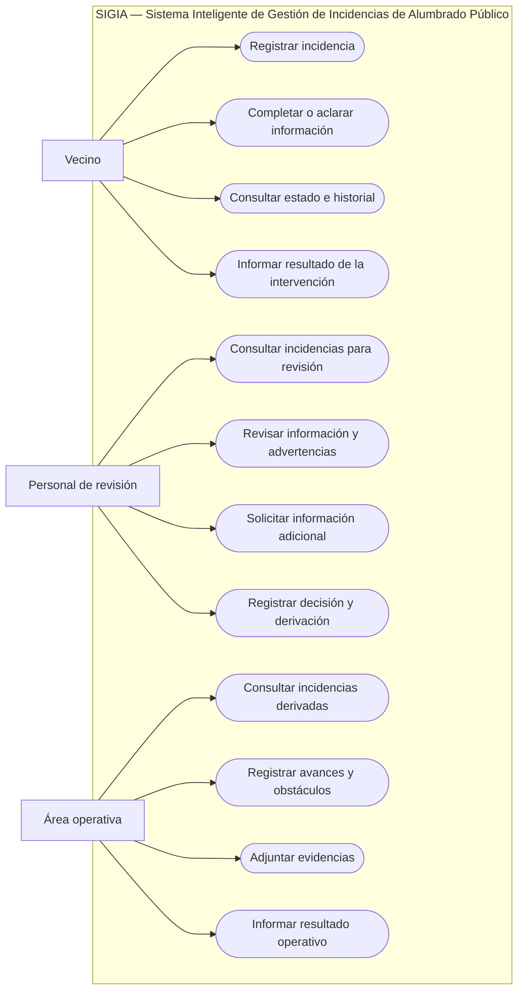

# Diagrama de casos de uso de SIGIA

## 1. Objetivo

El diagrama de casos de uso identifica las funcionalidades que SIGIA ofrece a los actores externos que interactúan con el prototipo.

A diferencia del diagrama de contexto, que muestra los intercambios de información entre el sistema y su entorno, este diagrama se concentra en las acciones que cada actor puede realizar utilizando SIGIA.

El modelo corresponde a una propuesta académica y a un prototipo independiente. No describe procedimientos internos confirmados de EMVIAL ni representa integraciones reales con sistemas municipales.

## 2. Actores

### Vecino

Persona que informa una incidencia de alumbrado público y puede consultar su seguimiento, completar información y comunicar si el problema continúa o si considera que fue solucionado.

### Personal de revisión

Rol encargado de analizar los reportes organizados por SIGIA, evaluar advertencias, solicitar aclaraciones y registrar cómo debe continuar cada incidencia.

### Área operativa

Rol que, dentro de la simulación, consulta las incidencias que le fueron derivadas y registra avances, obstáculos, evidencias y resultados informados.

La inteligencia artificial no aparece como actor porque forma parte de SIGIA. Es un componente interno que asiste en la interpretación, validación y organización de la información.

## 3. Diagrama de casos de uso

El siguiente esquema representa los actores, el límite del sistema y las principales funcionalidades. Se utiliza un diagrama de flujo con formas ovaladas para representar los casos de uso.

## 4. Descripción de los casos de uso

### Funciones del vecino

| Caso de uso | Descripción |
| --- | --- |
| Registrar incidencia | Ingresar un reporte de alumbrado público con ubicación y descripción del problema. |
| Completar o aclarar información | Responder pedidos de SIGIA y aportar datos faltantes o aclaraciones. |
| Consultar estado e historial | Consultar la situación actual y los movimientos registrados mediante el código de incidencia. |
| Informar resultado de la intervención | Comunicar si el problema continúa, se solucionó parcialmente o se considera solucionado. |

### Funciones del personal de revisión

| Caso de uso | Descripción |
| --- | --- |
| Consultar incidencias para revisión | Acceder a los reportes organizados que requieren intervención humana. |
| Revisar información y advertencias | Analizar los datos, las sugerencias de clasificación, las inconsistencias y los posibles duplicados. |
| Solicitar información adicional | Registrar un pedido de aclaración cuando los datos no son suficientes para continuar. |
| Registrar decisión y derivación | Registrar cómo continúa el caso y, cuando corresponda, derivarlo al área operativa dentro del flujo propuesto. |

### Funciones del área operativa

| Caso de uso | Descripción |
| --- | --- |
| Consultar incidencias derivadas | Consultar la información de las incidencias que recibió en la simulación. |
| Registrar avances y obstáculos | Informar el progreso, las demoras o las dificultades encontradas. |
| Adjuntar evidencias | Incorporar fotografías u otros elementos complementarios relacionados con la intervención informada. |
| Informar resultado operativo | Registrar el resultado comunicado de la intervención o indicar que no pudo resolverse. |

## 5. Relaciones y reglas del modelo

- Cada actor interactúa con SIGIA mediante las funciones que corresponden a su rol.
- El vecino no modifica decisiones administrativas ni el historial de revisión.
- El personal de revisión analiza la información y registra cómo debe continuar el caso.
- El área operativa informa avances y resultados, pero no realiza aprobaciones administrativas.
- Las comunicaciones entre el personal de revisión y el área operativa pasan por SIGIA en este modelo.
- La inteligencia artificial colabora internamente con la validación, interpretación, clasificación preliminar y preparación de resúmenes.
- Las sugerencias de IA no sustituyen la revisión ni las decisiones humanas.
- Las notificaciones y actualizaciones son mecanismos internos del sistema asociados a los casos de uso correspondientes; no se consideran actores independientes.

## 6. Ejemplo de interacción

Un ejemplo simplificado del uso del sistema sería:

1. El vecino registra una incidencia.
2. SIGIA valida los datos y solicita aclaraciones si son necesarias.
3. SIGIA organiza la información y prepara una clasificación preliminar.
4. El personal de revisión consulta el reporte y analiza las advertencias.
5. Si corresponde, el personal de revisión registra la derivación.
6. El área operativa consulta la incidencia y registra avances.
7. SIGIA actualiza el historial y permite que el vecino consulte el estado.
8. Se registra la respuesta del vecino sobre el resultado informado, si la hubiera.

## 7. Alcance del diagrama

Este diagrama presenta las funcionalidades principales previstas para el prototipo. No especifica todavía el orden temporal detallado de cada interacción ni las pantallas, reglas técnicas o estructuras de datos necesarias para implementarlas.

Esos aspectos podrán detallarse posteriormente mediante diagramas de secuencia, diseño de interfaz y especificaciones funcionales.

## 8. Cómo explicar el diagrama

El diagrama de casos de uso muestra qué funcionalidades ofrece SIGIA a cada actor. El vecino puede registrar y consultar incidencias; el personal de revisión puede analizar la información y registrar decisiones de continuidad; y el área operativa puede consultar las incidencias derivadas e informar avances y resultados.

El límite que rodea los casos de uso representa a SIGIA. Los actores quedan fuera porque interactúan con el sistema, pero no forman parte de él. La inteligencia artificial se considera un componente interno y, por eso, no se representa como actor externo.
