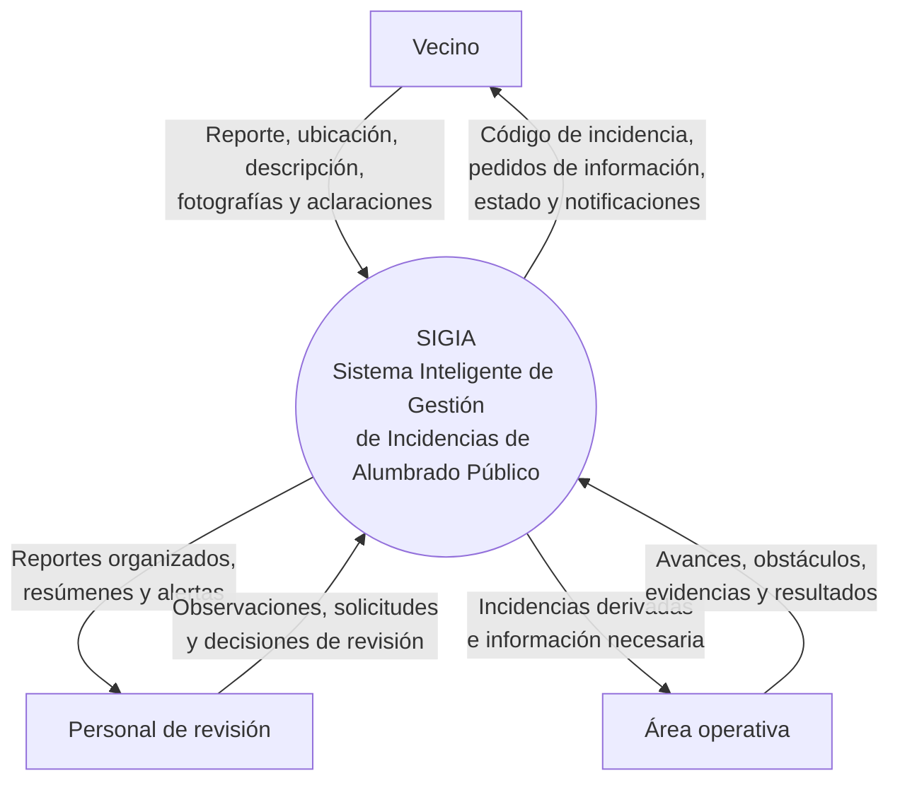

# Diagrama de contexto de SIGIA

## 1. Objetivo

El diagrama de contexto representa a SIGIA como un único sistema y muestra sus límites, los actores externos que interactúan con él y los principales intercambios de información.

El modelo presenta a SIGIA como eje central de comunicación: recibe información, la organiza y la pone a disposición de cada actor según su función. En esta propuesta, las comunicaciones entre el personal de revisión y el área operativa se realizan a través del sistema para conservar la trazabilidad.

Este diagrama corresponde al prototipo académico. No describe ni afirma reproducir los procedimientos internos reales de EMVIAL.

## 2. Diagrama

## 3. Actores externos e intercambios

### 3.1. Vecino

**Información que envía a SIGIA:**

- Reporte de una incidencia de alumbrado público.
- Dirección o ubicación y barrio.
- Descripción del problema.
- Fotografías, si dispone de ellas.
- Aclaraciones cuando el sistema solicita completar información.
- Respuesta sobre el resultado informado de una intervención, cuando corresponda.

**Información que recibe de SIGIA:**

- Código único de la incidencia.
- Solicitudes de información adicional.
- Confirmación de recepción dentro del prototipo.
- Estado e historial de seguimiento.
- Notificaciones sobre novedades relevantes.

### 3.2. Personal de revisión

**Información que recibe de SIGIA:**

- Reportes organizados.
- Resúmenes de las incidencias.
- Datos faltantes o inconsistentes.
- Advertencias sobre posibles duplicados.
- Casos que requieren revisión por ambigüedad.
- Actualizaciones y evidencias registradas durante el seguimiento.

**Información que envía a SIGIA:**

- Observaciones y correcciones.
- Solicitudes de información adicional.
- Resultado de la revisión.
- Decisión sobre cómo continuar dentro del flujo propuesto.
- Registro de la derivación al área operativa, cuando corresponda.

### 3.3. Área operativa

**Información que recibe de SIGIA:**

- Incidencias derivadas para su atención en la simulación.
- Ubicación y descripción del problema.
- Información complementaria disponible.
- Observaciones relevantes para el seguimiento.

**Información que envía a SIGIA:**

- Actualizaciones sobre el avance.
- Obstáculos o motivos de demora.
- Necesidad de materiales u otros recursos, como dato de seguimiento.
- Evidencias complementarias.
- Resultado informado de la intervención o indicación de que no pudo resolverse.

## 4. SIGIA como eje central

SIGIA centraliza la información de cada incidencia y facilita el intercambio entre los actores. Cada actor accede a la información necesaria según su responsabilidad.

Por ejemplo, cuando el personal de revisión registra una derivación, SIGIA pone la información correspondiente a disposición del área operativa. Luego, el área operativa registra sus avances en el sistema y el personal de revisión puede consultarlos desde allí.

En este modelo no se representan comunicaciones directas entre el personal de revisión y el área operativa por fuera de SIGIA. Esta decisión permite mantener un historial común de derivaciones y actualizaciones.

## 5. Elementos que no aparecen como actores externos

- **Inteligencia artificial:** es un componente interno de SIGIA. Colabora con la interpretación, validación, clasificación preliminar y organización de la información; no es un actor externo.
- **EDEA:** forma parte del entorno relacionado con el suministro eléctrico, pero no interactúa directamente con el prototipo. SIGIA no consulta ni modifica sistemas de EDEA.
- **Municipalidad y EMVIAL:** constituyen el contexto institucional del proyecto. El prototipo académico no se conecta con sus sistemas internos ni ejecuta operaciones reales.

## 6. Alcance y límites

El diagrama muestra intercambios de información, no conexiones técnicas reales ni integraciones implementadas.

Los actores y sus responsabilidades representan roles funcionales propuestos para la simulación. No deben interpretarse como una descripción confirmada de la estructura interna o de los procedimientos vigentes de EMVIAL.

Todos los ejemplos y pruebas del prototipo utilizarán datos ficticios. SIGIA no recibe reclamos reales, no asigna cuadrillas ni emite órdenes de trabajo reales.

## 7. Cómo explicar el diagrama

SIGIA se representa en el centro porque es el sistema que recibe, organiza y distribuye la información de las incidencias. El vecino aporta los reportes y recibe información sobre su seguimiento. El personal de revisión analiza los datos organizados y registra cómo debe continuar cada caso. El área operativa recibe la información derivada y comunica avances y resultados. Todos esos intercambios pasan por SIGIA, lo que permite centralizar la información y mantener la trazabilidad.

El diagrama de contexto muestra quiénes interactúan con SIGIA y qué información intercambian. No detalla los pasos internos de cada proceso; esos aspectos se desarrollarán en los diagramas siguientes.
