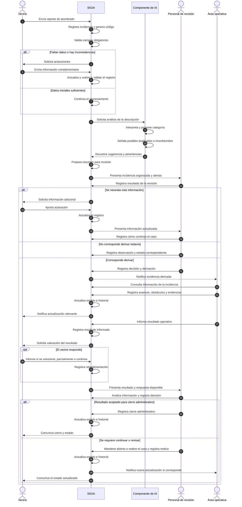

# Diagrama de secuencia de SIGIA

## 1. Objetivo

El diagrama de secuencia representa, en orden temporal, cómo interactúan los actores y los componentes de SIGIA durante el tratamiento de una incidencia de alumbrado público.

Mientras que el diagrama de contexto muestra los intercambios generales y el diagrama de casos de uso identifica las funcionalidades, el diagrama de secuencia permite observar el orden de los mensajes y las respuestas durante un escenario.

Este modelo corresponde al funcionamiento propuesto para el prototipo académico. No describe procedimientos internos confirmados de EMVIAL ni representa integraciones reales con sistemas municipales.

## 2. Participantes

- **Vecino:** registra la incidencia, aporta aclaraciones y consulta el seguimiento.
- **SIGIA:** recibe y organiza la información, valida datos, administra estados e historial y distribuye la información a los roles correspondientes.
- **Componente de IA:** componente interno de SIGIA que ayuda a interpretar la descripción, sugerir una categoría y señalar posibles inconsistencias o duplicados. No toma decisiones administrativas.
- **Personal de revisión:** analiza la información y las advertencias, decide cómo continúa el caso y es responsable del cierre administrativo.
- **Área operativa:** consulta las incidencias derivadas e informa avances, obstáculos, evidencias y resultados de la intervención simulada.

La IA se muestra como una línea de vida interna para hacer visible su participación técnica. No es un actor externo ni un usuario independiente del sistema.

## 3. Diagrama de secuencia principal

El siguiente diagrama muestra el flujo desde el registro inicial hasta el cierre administrativo, incluyendo caminos alternativos cuando falta información, existe incertidumbre o el problema no se considera resuelto.

## 4. Explicación de las etapas

### Etapa 1. Registro

El vecino envía un reporte. SIGIA crea un registro y genera un código único para identificar la incidencia.

### Etapa 2. Validación

SIGIA verifica si están presentes los datos necesarios. Si falta información o detecta inconsistencias, solicita aclaraciones. Cuando recibe una respuesta, vuelve a validar el registro.

### Etapa 3. Asistencia de inteligencia artificial

El componente de IA interpreta la descripción y propone una categoría preliminar. También puede advertir posibles duplicados o señalar que la información es ambigua.

El resultado se devuelve a SIGIA como sugerencia. La IA no aprueba, rechaza ni deriva por sí misma la incidencia.

### Etapa 4. Revisión humana

SIGIA presenta la información organizada al personal de revisión. Este rol analiza el reporte, las sugerencias y las advertencias y registra cómo debe continuar el caso.

Si se necesitan aclaraciones, se solicitan al vecino. Si corresponde continuar con una derivación, el personal de revisión la registra en SIGIA.

### Etapa 5. Seguimiento operativo

El área operativa consulta la incidencia derivada y registra los avances, obstáculos, evidencias y resultados informados.

La comunicación entre el área operativa y el personal de revisión se realiza mediante SIGIA en este modelo, de modo que las actualizaciones queden registradas.

### Etapa 6. Retroalimentación del vecino

Cuando se informa un resultado, SIGIA puede solicitar al vecino que indique si el problema fue solucionado, se resolvió parcialmente o continúa.

La respuesta se registra como información de seguimiento. Si no hay respuesta, el sistema no debe interpretarla como una confirmación de solución.

### Etapa 7. Cierre administrativo

El personal de revisión analiza el resultado informado y la respuesta del vecino, si existe. Solamente este rol registra el cierre administrativo dentro del modelo propuesto.

Si la información indica que el problema continúa o que hace falta revisar el caso, se mantiene abierto o se reabre con el motivo correspondiente.

## 5. Reglas que se desprenden del diagrama

1. Toda incidencia recibe un código único.
2. Los datos faltantes generan una solicitud de aclaración; SIGIA no inventa información.
3. La IA propone una clasificación, pero no toma decisiones administrativas.
4. Los posibles duplicados se señalan para revisión humana y no se eliminan automáticamente.
5. El personal de revisión decide si corresponde registrar una derivación.
6. El área operativa informa avances y resultados, pero no realiza el cierre administrativo.
7. La respuesta del vecino se registra como retroalimentación, sin asumir que confirma por sí sola una reparación.
8. La falta de respuesta del vecino no equivale a una confirmación de solución.
9. El cierre administrativo queda exclusivamente a cargo del personal de revisión.
10. Los cambios relevantes deben conservar su trazabilidad en el historial de la incidencia.

## 6. Alcance y simplificaciones

El diagrama representa un escenario general y reúne alternativas posibles para explicar el funcionamiento. En una implementación, cada alternativa podría detallarse en diagramas de secuencia más pequeños.

Los mensajes representan intercambios lógicos de información, no integraciones técnicas ya implementadas. Los actores y roles son parte del diseño académico del prototipo y no describen necesariamente la distribución real de tareas dentro de EMVIAL.

El prototipo se probará con datos ficticios, sin enviar reclamos reales ni comunicarse con sistemas de la Municipalidad, EMVIAL o EDEA.

## 7. Cómo explicar el diagrama

El diagrama de secuencia muestra el orden en que se producen las interacciones. Primero, el vecino registra una incidencia y SIGIA valida la información. Luego, el componente de IA ayuda a interpretar y organizar el reporte. El personal de revisión analiza el resultado y decide cómo continuar. Si se deriva, el área operativa registra avances y comunica el resultado a través de SIGIA. Finalmente, el personal de revisión evalúa la información y es el único rol que puede registrar el cierre administrativo.

El objetivo del diagrama es mostrar que SIGIA centraliza el intercambio de información y conserva la trazabilidad, mientras que las decisiones administrativas permanecen bajo responsabilidad humana.
